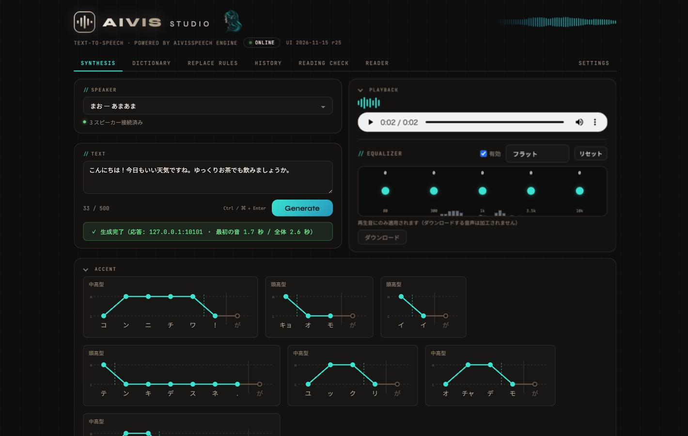
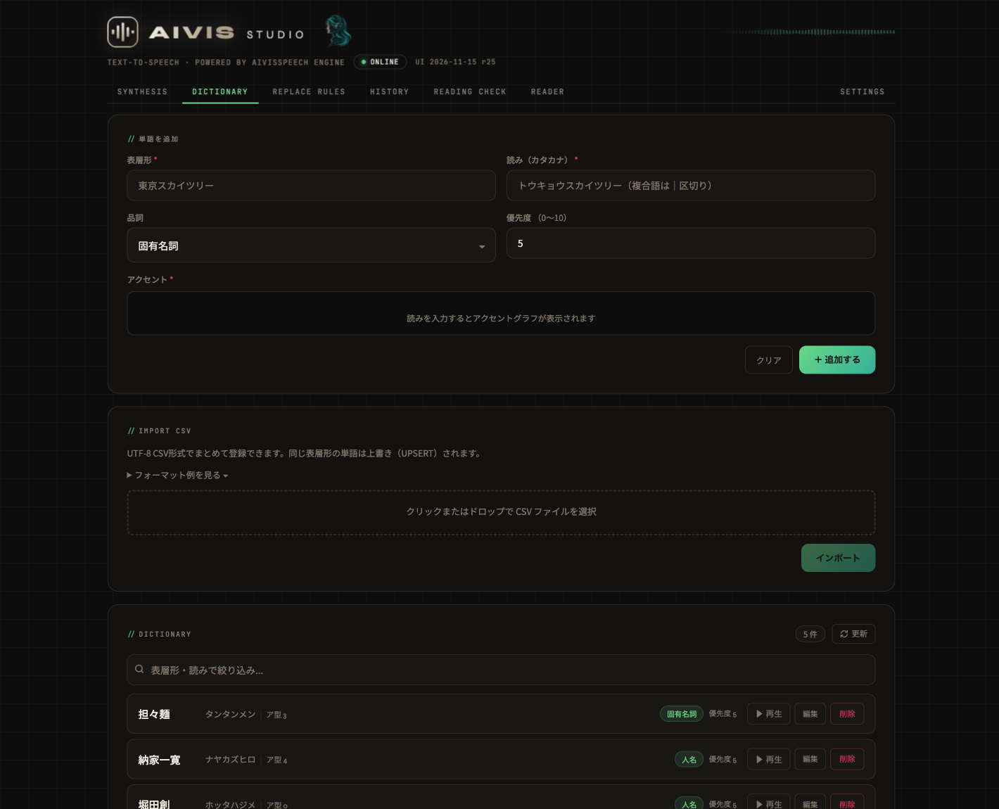
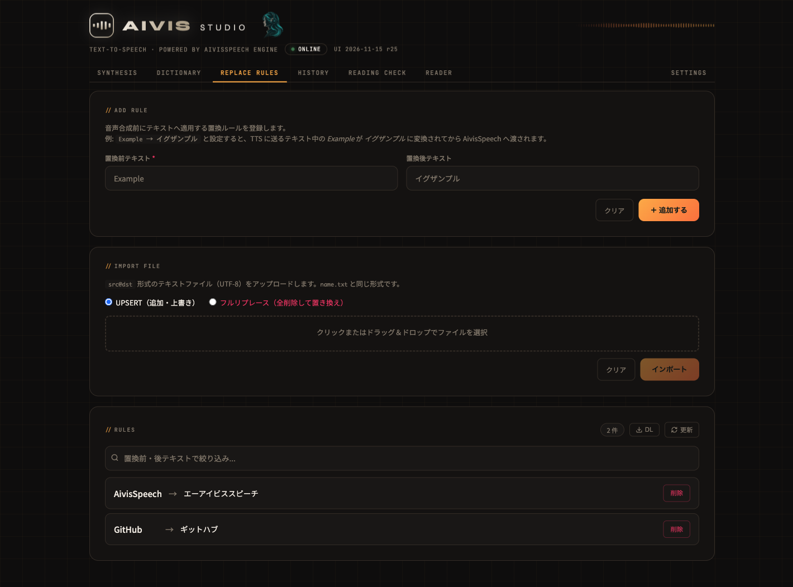
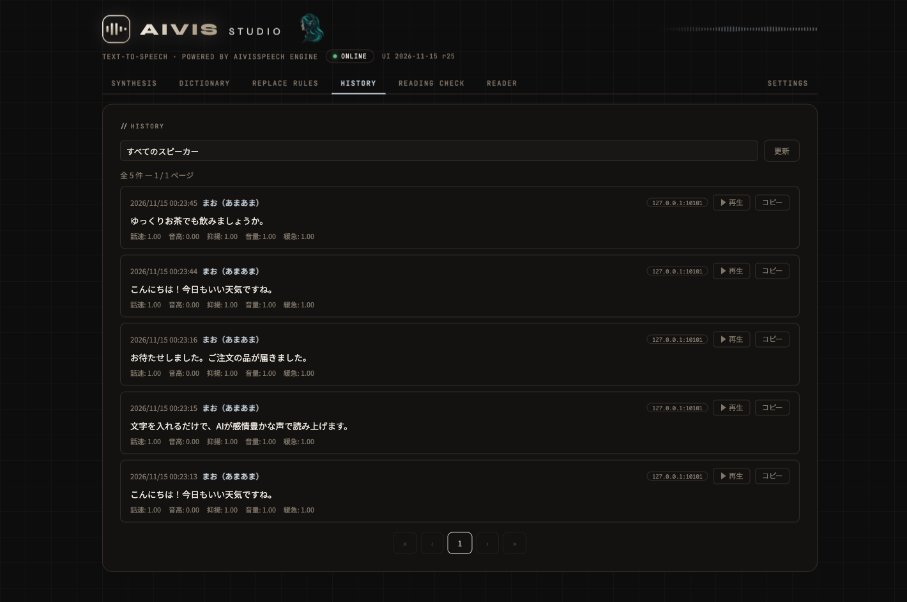
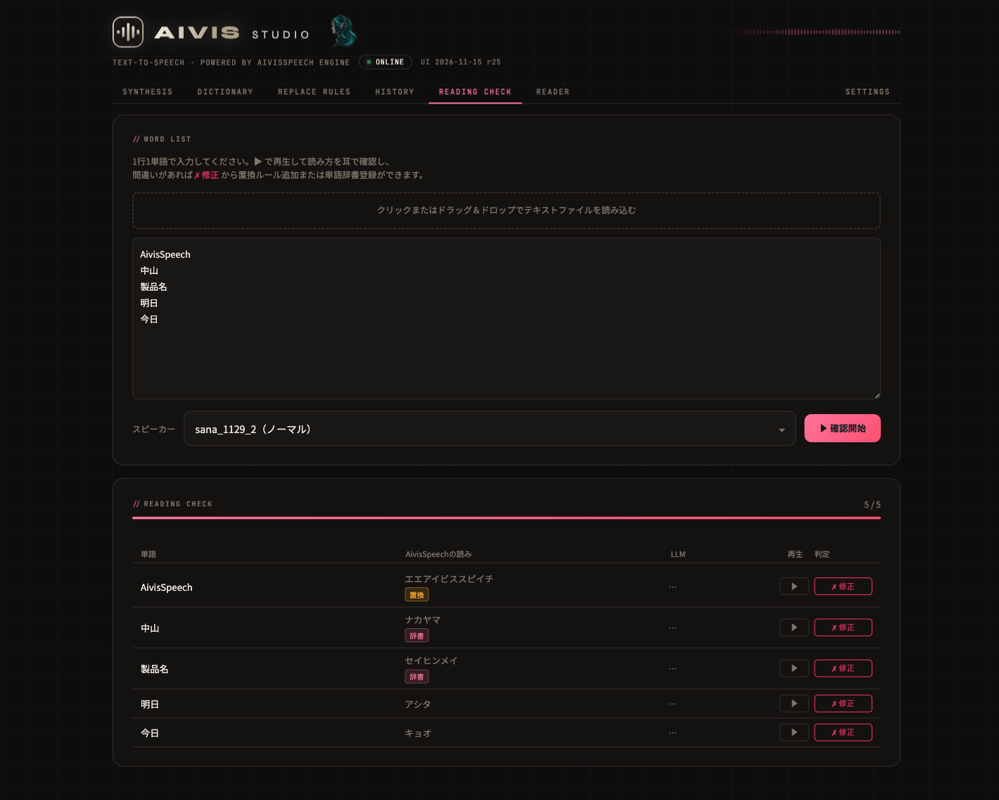
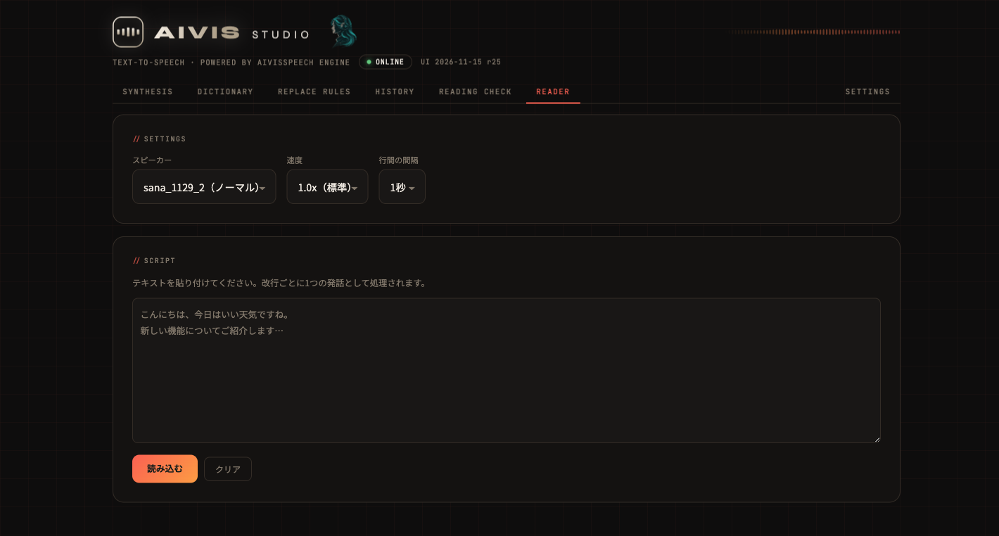
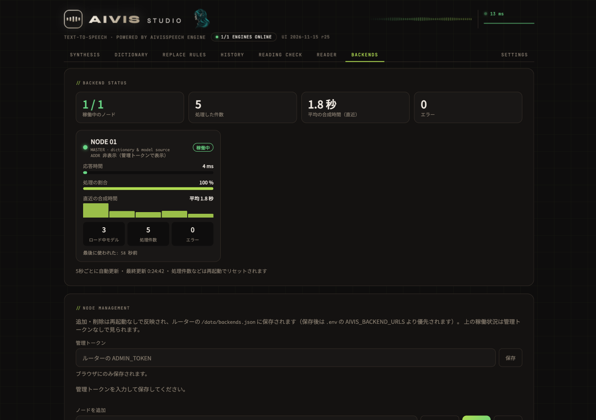

<p align="center">
  
</p>

<h1 align="center">AivisSpeech Studio WebUI</h1>

<p align="center">
  <b>感情豊かなAI音声を、ブラウザだけで。</b><br>
  文章を入れて、声を選んで、再生する。読み間違いは辞書と置換ルールでその場で直せます。
</p>

<p align="center">
  
</p>

> PCにインストールして使いたい人は、デスクトップ版（ダウンロードして開くだけ）があります。
> [hit1023/aivis-desktop](https://github.com/hit1023/aivis-desktop)
> このリポジトリは、サーバーで動かしてブラウザから使う版です。デスクトップ版の画面も、ここの `index.html` をそのまま使っています。

---

## 特長

| | |
|---|---|
| **かんたんに使える** | 文章を入れて「Generate」を押すだけ。サーバー管理など自宅サーバー向けの機能は「かんたんモード」で隠せます。 |
| **細かく調整できる** | 話速・音高・抑揚・音量・緩急・無音の長さを調整。生成後はアクセント句ごとのピッチ曲線も確認できます。 |
| **読みを直せる** | 単語辞書と置換ルールで、固有名詞や英字の読みを登録。「読みチェック」で一括確認もできます。 |
| **聞こえ方を整える** | 再生プレイヤーに5バンドのイコライザーとスペクトラム表示。ダウンロードする音声には影響しません。 |
| **履歴とプリセット** | 発話履歴をあとから再生・コピー。話者ごとのパラメータはプリセットとして保存され、自動で適用されます。 |
| **複数サーバー対応** | 複数のAivisSpeechエンジン（ルーター経由）に処理を振り分け、稼働状況をリアルタイムで確認できます。 |
| **台本の通し読み** | 改行ごとに1つの発話として、順番に読み上げます。行間の間隔と速度を選べます。 |

---

## 画面の紹介

### 音声合成（Synthesis）

- 話者とスタイルを選び、テキスト（最大500文字）を入力して生成。Ctrl / Cmd + Enter でも生成できます。
- 話速・音高・抑揚・音量・緩急・無音倍率を調整。調整中の値をそのまま `curl` コマンドとして確認・コピーできます。
- 生成後にアクセント句ごとのピッチ曲線を表示。生成に6秒以上かかると、モデル読み込み中の可能性があることと経過秒数を表示します。
- MP3の再生とダウンロード。再生カードの5バンドイコライザーは再生音だけに効き、設定はブラウザに保存されます。
- 話者ごとのパラメータをプリセット保存。VRAMへのロード状態の確認と強制アンロード、`.aivmx` モデル（[Aivis Hub](https://hub.aivis-project.com/) で入手できます）のインストール（ドラッグ＆ドロップ）とアンインストールにも対応しています。

### 単語辞書（Dictionary）

<p align="center"></p>

- 固有名詞・読み方をユーザー辞書に登録。ひらがな入力は自動でカタカナに変換されます。
- 読みを入力するとアクセントグラフが現れ、スライダーでピッチ曲線を動かしながら確認できます。
- 登録した単語は行の「再生」ですぐに聞き比べられます。検索・編集・削除、CSVでの一括インポートにも対応しています。

### 置換ルール（Replace Rules）

<p align="center"></p>

- 音声合成の前にテキストへ適用する置換ルールを管理します。英字の固有名詞の誤読対策に向いています。
- ルールの追加・検索・削除（削除は2段階確認で誤操作を防止）。`src@dst` 形式の `.txt` をドラッグ＆ドロップで一括取り込み（追加・上書き／全入れ替え）、`name.txt` としてエクスポートもできます。

> **単語辞書と置換ルールの使い分け**
> 英字の単語は辞書に登録するとカタカナに変換されてしまい、文脈によって効かないことがあります。英字の固有名詞には置換ルールを使うのが確実です。

### 履歴（History）

<p align="center"></p>

- すべての発話を新しい順に一覧表示。話者での絞り込み、ページ送りに対応しています。
- 「再生」でその発話と同じ設定の音声を即時に再生（もう一度押すと停止）、「コピー」でテキストをクリップボードへ。

### 読みチェック（Reading Check）

<p align="center"></p>

- 単語リスト（1行1単語、または `.txt` の読み込み）を一括で処理し、AivisSpeechが実際に付ける読みをカナで表示します。辞書・置換で設定済みの単語には、その印が付きます。
- 「再生」で耳で確認し、読みが違えば「修正」から、置換ルールへ1クリックで追加、または単語辞書の登録フォームへ（単語と読みは入力済み）。
- 設定タブでOpenAI互換API（Ollama・OpenAIなど）か Claude Code ヘッドレスを指定すると、LLMによる読みの自動判定も使えます（詳細モード）。LLMには単語と読みだけが送られます。

### 台本読み上げ（Reader）

<p align="center"></p>

- テキストを貼り付けて「読み込む」と、改行ごとに1つの発話に分かれます。話者・速度（0.8x〜1.5x）・行間の間隔（なし〜3秒）を選んで「全て再生」。

### バックエンド（Backends）

<p align="center"></p>

詳細モードで表示されるタブです。自宅サーバーなどで複数のエンジンを動かす人向けです。

- **稼働状況**（管理トークン不要、5秒ごとに自動更新）: 稼働ノード数・処理件数・平均合成時間のほか、ノードごとに死活・応答時間・処理の割合・直近20件の合成時間・ロード中モデル数・エラー数を表示します。
- **ノード管理**: マスターノードの切り替え（辞書とモデルの基準になり、他のノードが追従）、ノードの追加（接続テスト付き）と削除を、再起動なしで反映します。追加時は不足モデルを自動で導入し、辞書は最初のノードからコピーされます。ルーター側の `ADMIN_TOKEN` が必要で、ブラウザにのみ保存されます。

### 表示モード（かんたん / 詳細）

自宅サーバー向けの機能（バックエンドタブ、稼働グラフ、LLMによる読み確認）を隠す「かんたんモード」があります。

- 既定値: `.env` の `AIVIS_UI_MODE=simple`（未設定は `full`）
- 切り替え: 設定タブの「表示モード」、または URL に `?mode=simple` / `?mode=full`（ブラウザに保存されます）

画面はスマホにも対応しています（設定タブで文字サイズを変えられます）。

---

## 必要な環境

- Docker / Docker Compose
- [AIVIS Router](https://github.com/hit1023/hit-aivis-router) が起動していること（AivisSpeech Engine へ中継するAPIです）

## セットアップ

```bash
git clone git@github.com:hit1023/hit-aivis-webui.git
cd hit-aivis-webui
docker compose up -d
```

ブラウザで `http://localhost:8889` を開きます。

### 接続先APIの変更

`.env` ファイルで `AIVIS_API_URL` を設定します。

```env
AIVIS_API_URL=https://your-aivis-router-url
```

コンテナ起動時に `docker-entrypoint.sh` が `index.html` 内のプレースホルダーを置き換えます。設定タブから、ブラウザごとに接続先とAPIキーを変えることもできます。

---

## ライセンスとクレジット

- **AivisSpeech / AivisSpeech Engine**: [Aivis Project](https://github.com/Aivis-Project)（LGPL-3.0）。このリポジトリには含まれていません。音声合成はエンジン側が行います。
- **音声モデル**: [Aivis Hub](https://hub.aivis-project.com/) でダウンロードできます。モデルごとに利用規約・ライセンスがあります（例: ACML）。使うモデルの条件に従ってください。
- **フォント**: Syne、JetBrains Mono、Noto Sans JP（いずれも SIL Open Font License 1.1）を Google Fonts から読み込みます。
- **イラスト**: ヘッダーのキャラクターなどの画像は、作者が用意したものです。

---

## 更新履歴

- **2026-11** かんたんモードを追加。配色を暖色ダークとタブ別アクセントに刷新し、絵文字を排除。ヘッダーにマスコットとビジュアライザーを追加。台本読み上げタブ、5バンドイコライザー、バックエンドの稼働ダッシュボードとノード管理を追加。
- **2026-05** 発話履歴・読みチェック・置換ルールの一括管理を追加。アクセント可視化、スピーカープリセット、モデルのアンインストール、緩急・無音倍率の調整、モデルアップロード、接続先の環境変数化を追加。
- **2025-05** 単語辞書（アクセントビジュアライザー付き）、置換ルール、VRAMロード状態の表示を追加。
- **初期リリース** 音声合成フォーム、スピーカー選択、パラメータ調整、MP3の再生とダウンロード。
